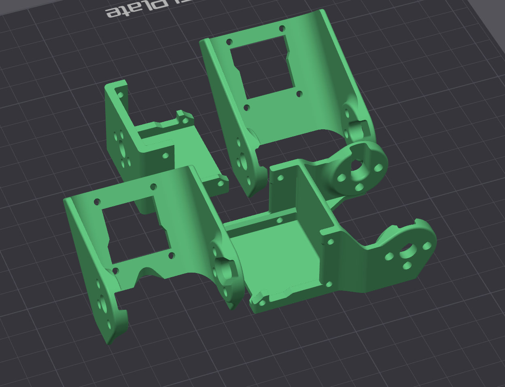
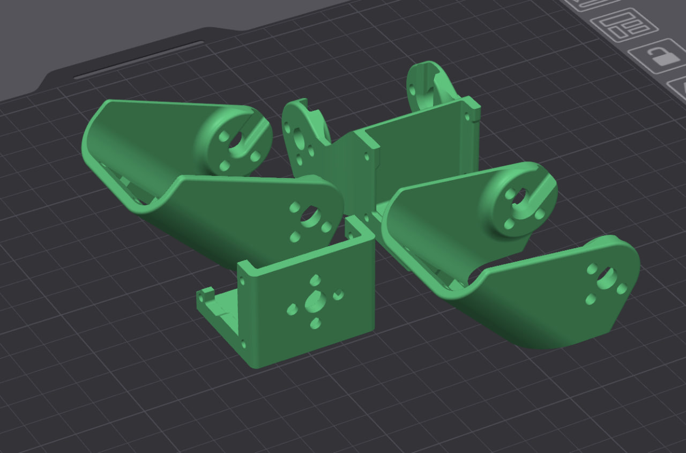

# Детали для 3D-печати

| Файл | Деталь | Для чего |
|---|---|---|
| `КТ.0002.04Г.00.002_Звено 1.stl` | Звено 1 | Пластиковый манипулятор |
| `КТ.0002.04Г.00.003_Звено 2.stl` | Звено 2 | Пластиковый манипулятор |
| `КТ.0002.04Г.00.004_Звено 3.stl` | Звено 3 | Пластиковый манипулятор |
| `КТ.0002.04Г.00.005_Звено 4.stl` | Звено 4 | Пластиковый манипулятор |
| `КТ.0022.02.00.023_Бампер.stl` | Бампер | Мобильная платформа |
| `КТ_0022_02_00_048_Переходник_для_платы_лидара.obj` | Переходник для платы лидара | Крепление платы-адаптера лидара YDLIDAR X3 Pro |

Звенья пластикового манипулятора на столе принтера:

Сборка и настройка манипулятора — в папке [`manipulator`](../manipulator): приложение «Конфигуратор манипулятора» и инструкция к нему.
