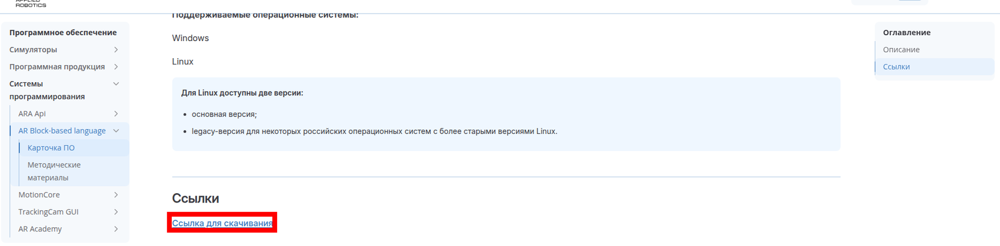
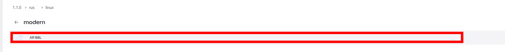
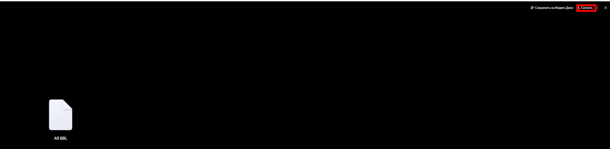
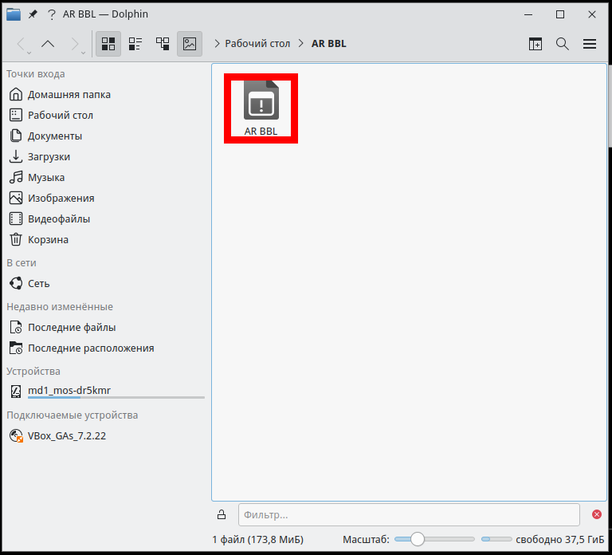
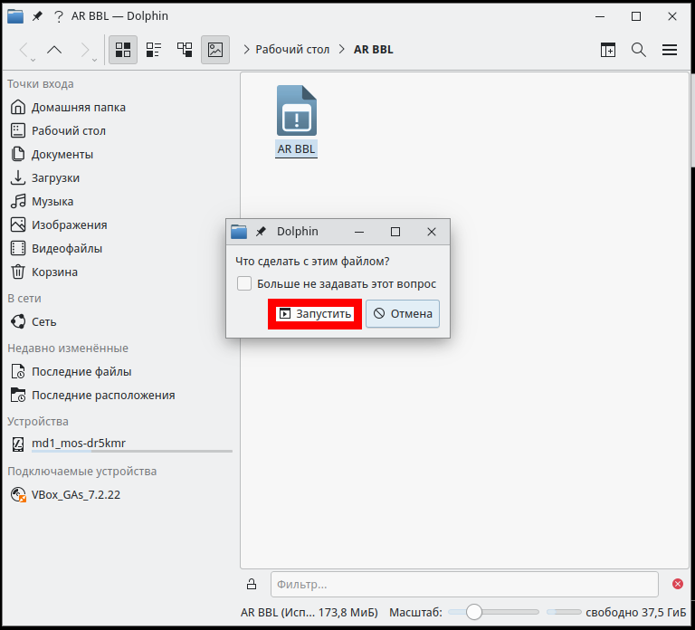
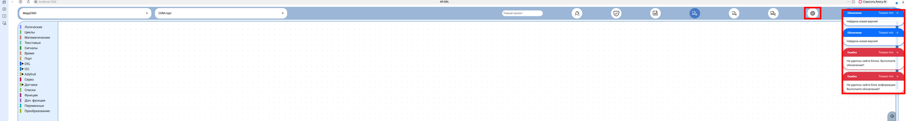
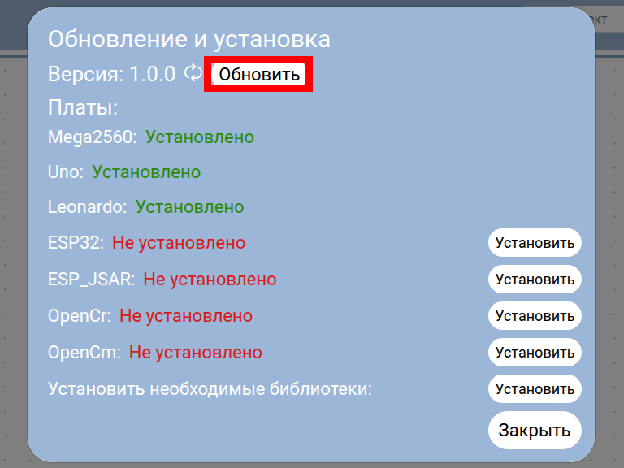
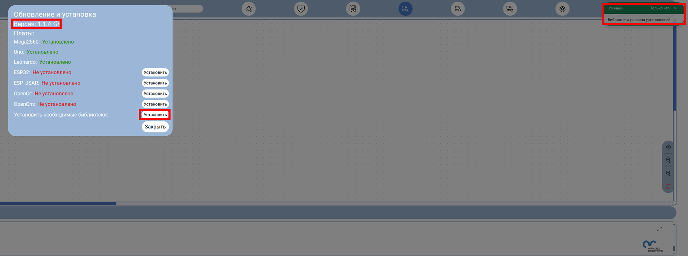
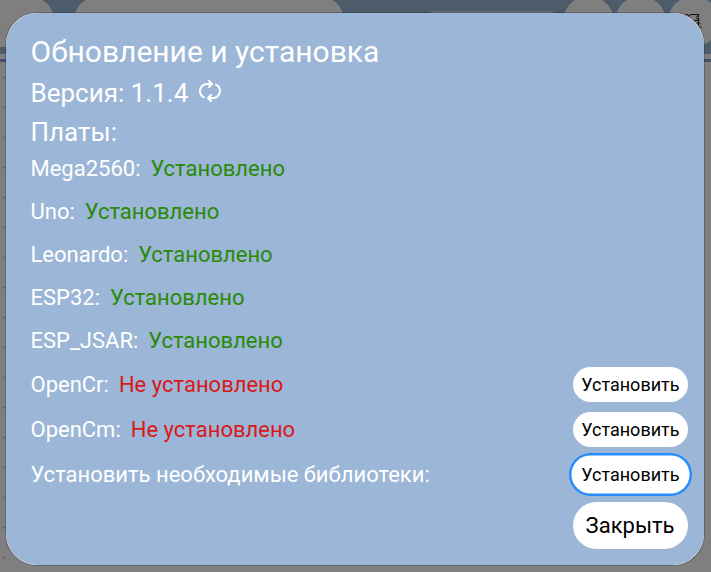

# Установка AR BBL в МОС Desktop 12

AR BBL скачивается с Яндекс Диска одним исполняемым файлом, его кладут в папку на рабочем столе и запускают оттуда; библиотеки среда доустанавливает сама.

## Что понадобится

- Компьютер с МОС Desktop 12 и доступом в интернет.

- Браузер (в инструкции — Яндекс Браузер): среда AR BBL открывается в его окне.

- Около 200 МБ свободного места: сам файл занимает 173,8 МиБ, плюс библиотеки, которые среда скачает сама.

## Шаг 1. Откройте карточку AR BBL на вики и найдите ссылку на скачивание

Откройте в браузере страницу https://wiki.appliedrobotics.ru/software/BBL/card.html. В разделе «Ссылки» нажмите «Ссылка для скачивания» — она ведёт на Яндекс Диск. Для Linux там описаны две версии: основная (папка modern) и legacy для российских систем со старыми версиями Linux. Для МОС Desktop 12 берём основную.



## Шаг 2. На Яндекс Диске скачайте исполняемый файл

На Яндекс Диске последовательно откройте папки rus → linux → modern (путь виден над списком файлов). В папке modern лежит один файл — «AR BBL» (около 174 МБ). Откройте его, в правом верхнем углу нажмите «Скачать». Браузер сохранит файл в папку «Загрузки».





## Шаг 3. Положите файл в папку на рабочем столе и разрешите запуск

Создайте на рабочем столе папку «AR BBL» и перенесите в неё файл из «Загрузки». Среда хранит рядом с собой свои данные, поэтому лучше запускать её из отдельной папки.

Скачанный файл не имеет права на выполнение, его нужно выдать. Откройте терминал (Konsole) и выполните:

```bash
chmod +x ~/"Рабочий стол"/"AR BBL"/"AR BBL"
```

В Dolphin папка на рабочем столе выглядит так (значок файла стал исполняемым):



## Шаг 4. Запустите среду из папки

Откройте папку «AR BBL» в Dolphin и запустите файл «AR BBL» двойным щелчком. Dolphin спросит, что сделать с файлом, — выберите «Запустить».



Через несколько секунд в браузере откроется среда по адресу localhost:7222. При первом запуске среда сообщает «Найдена новая версия» и показывает ошибки «Не удалось найти блоки. Выполните обновление!» — это нормально: блоки и библиотеки ещё не загружены. Следующий шаг это исправляет.



## Шаг 5. Обновите среду и установите библиотеки

В верхней панели нажмите кнопку-шестерёнку «Установка и обновление». Откроется окно «Обновление и установка».

1.  Нажмите «Обновить». Версия сменится с 1.0.0 на 1.1.4, кнопка исчезнет.

2.  Нажмите «Установить» в строке «Установить необходимые библиотеки». В окне вывода внизу пойдёт список установки библиотек, а в углу появится сообщение «Библиотеки успешно установлены!».





Платы Mega2560, Uno и Leonardo сразу отмечены как установленные.

После обновления приложения и установки поддержки ESP32 и установки библиотек окно будет выглядеть следующим образом:


