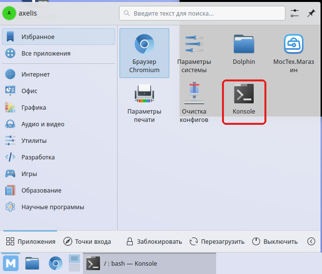
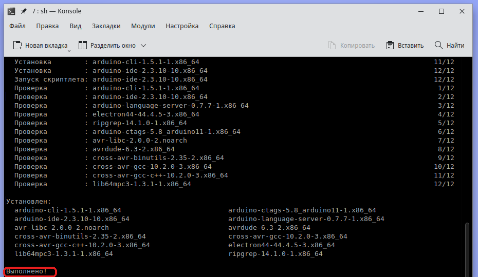
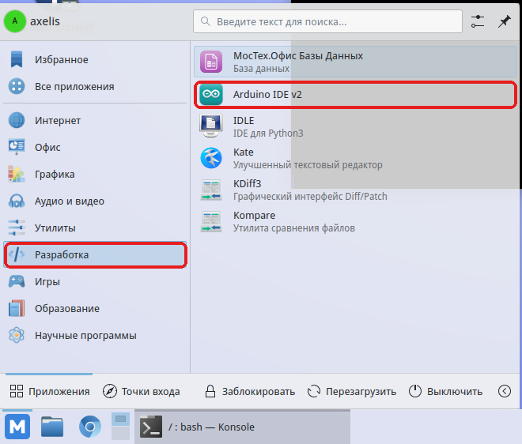
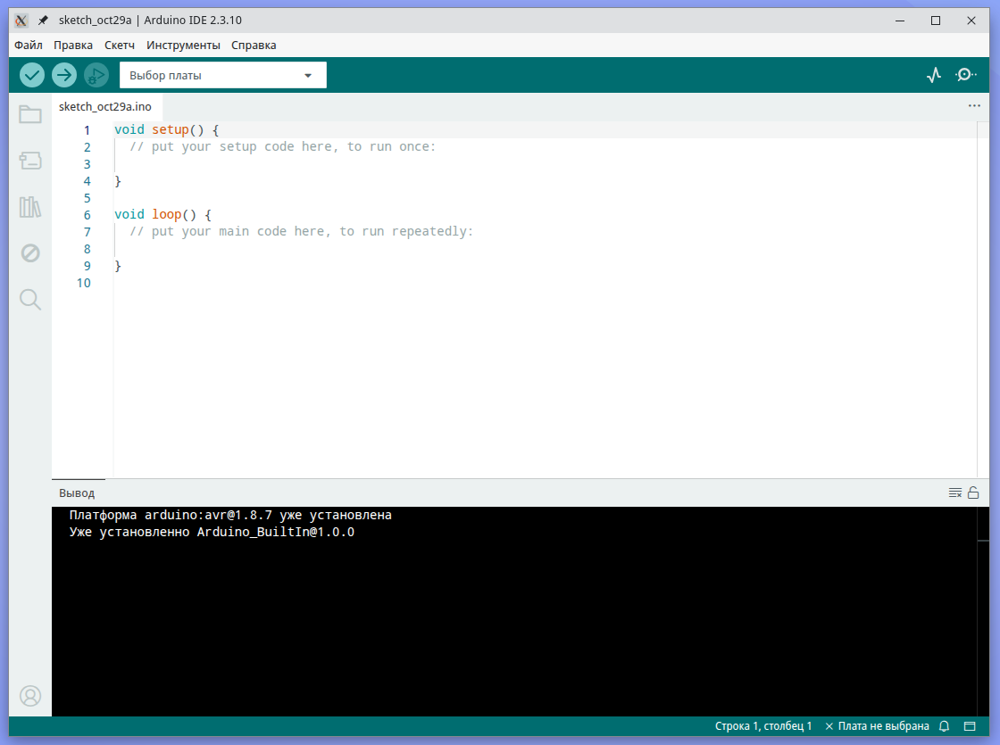
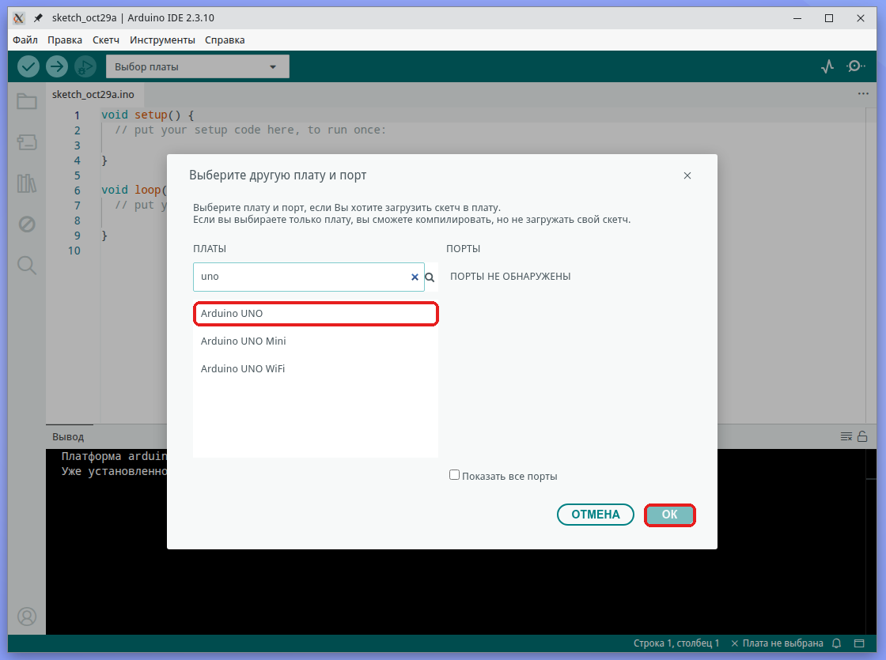
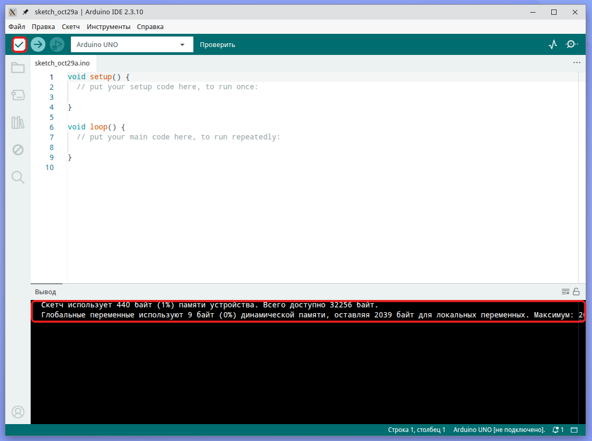

# Установка Arduino IDE в МОС Desktop 12

Arduino IDE 2.3.10 ставится в МОС одной командой, а платформа AVR и школьные библиотеки уже входят в пакет.

## Что понадобится

- МОС Desktop 12 (x86_64), доступ в интернет и учётная запись с правом sudo (группа wheel).

- Проверено в виртуальной машине VirtualBox: ядро 6.18.59, пакет arduino-ide-2.3.10-10 из репозитория системы.

- Плата к компьютеру при проверке не подключалась, поэтому загрузка скетча в реальную плату не проверена.

## Шаг 1. Откройте терминал

Нажмите кнопку меню «М» в левом нижнем углу и выберите **Konsole** (терминал).



## Шаг 2. Установите пакет

В терминале выполните команду:

```bash
sudo dnf install arduino-ide
```

Введите пароль (при вводе символы не отображаются) и подтвердите установку, нажав y. В тесте команда запускалась с ключом -y, поэтому вопроса не было. В конце появится сообщение «Выполнено!» и список установленных пакетов.



## Шаг 3. Дайте доступ к портам USB

Чтобы загружать скетчи в плату, пользователю нужно входить в группу dialout (в МОС она владеет последовательными портами). Выполните:

```bash
sudo usermod -aG dialout $USER
```

Затем **выйдите из сеанса и войдите снова** (или перезагрузите компьютер): группы применяются только к новому сеансу. Проверить можно командой groups — в списке должно быть слово dialout.

В тесте команда getent group dialout сразу показала пользователя в группе, а groups в текущем сеансе ещё нет — это нормально до повторного входа.

## Шаг 4. Запустите Arduino IDE

Откройте меню «М» → **Разработка** → **Arduino IDE v2**.



Первый запуск занимает несколько секунд. Откроется окно редактора с пустым скетчем. Интерфейс русифицирован, платформа arduino:avr (версия 1.8.7) уже установлена вместе с программой, дополнительно скачивать её не нужно.



## Шаг 5. Выберите плату и проверьте сборку

1.  В панели сверху откройте список «Выбор платы» и нажмите «Выберите другую плату и порт…».

2.  В поле поиска введите uno, выберите **Arduino UNO** и нажмите **OK**. Порт нужен только для загрузки, для проверки сборки он не обязателен.



3.  Нажмите кнопку «Проверить» (галочка в левом верхнем углу). В нижней панели появится сообщение об размере скетча. В тесте пустой скетч собрался без ошибок: «Скетч использует 440 байт (1%)…».



## Шаг 6. Загрузите скетч в плату

Если МОС работает на обычном компьютере, просто подключите плату кабелем USB и переходите к пункту 3. В виртуальной машине VirtualBox сначала нужно передать плату гостевой системе.

1.  (Только VirtualBox) В окне виртуальной машины откройте **Устройства → USB** и выберите плату в списке. У плат с чипом CH340 она называется «QinHeng Electronics USB Serial». Рядом с устройством появится галочка. Для USB-меню нужен Extension Pack.

2.  После подключения в МОС появится порт /dev/ttyUSB0 (у плат с другими чипами — /dev/ttyACM0). В тесте драйвер ch341 загрузился сам.

3.  В Arduino IDE откройте «Файл → Примеры → 01.Basics → Blink». Откроется новое окно с примером.

4.  В списке плат выберите **Arduino UNO** и порт /dev/ttyUSB0 (в списке он подписан «Неизвестно», это нормально для клонов с CH340), нажмите OK.

5.  Нажмите «Загрузить» (стрелка вправо). Скетч соберётся (976 байт) и запишется в плату. Запись может занять больше минуты; надпись «Загружаю на плату» в окне виртуальной машины может задержаться.

6.  Результат: светодиод L на плате мигает раз в секунду. В тесте он мигал.

Если загрузка не проходит, проверьте модель платы: у Arduino Nano часто нужен вариант «ATmega328P (Old Bootloader)».

## Что пока не проверено

- Espruino и блочно-графическая среда — отдельные инструкции, которые следуют за этой.

- Работа на настоящем компьютере с МОС (не в виртуальной машине) и платы с другими чипами USB (не CH340).
