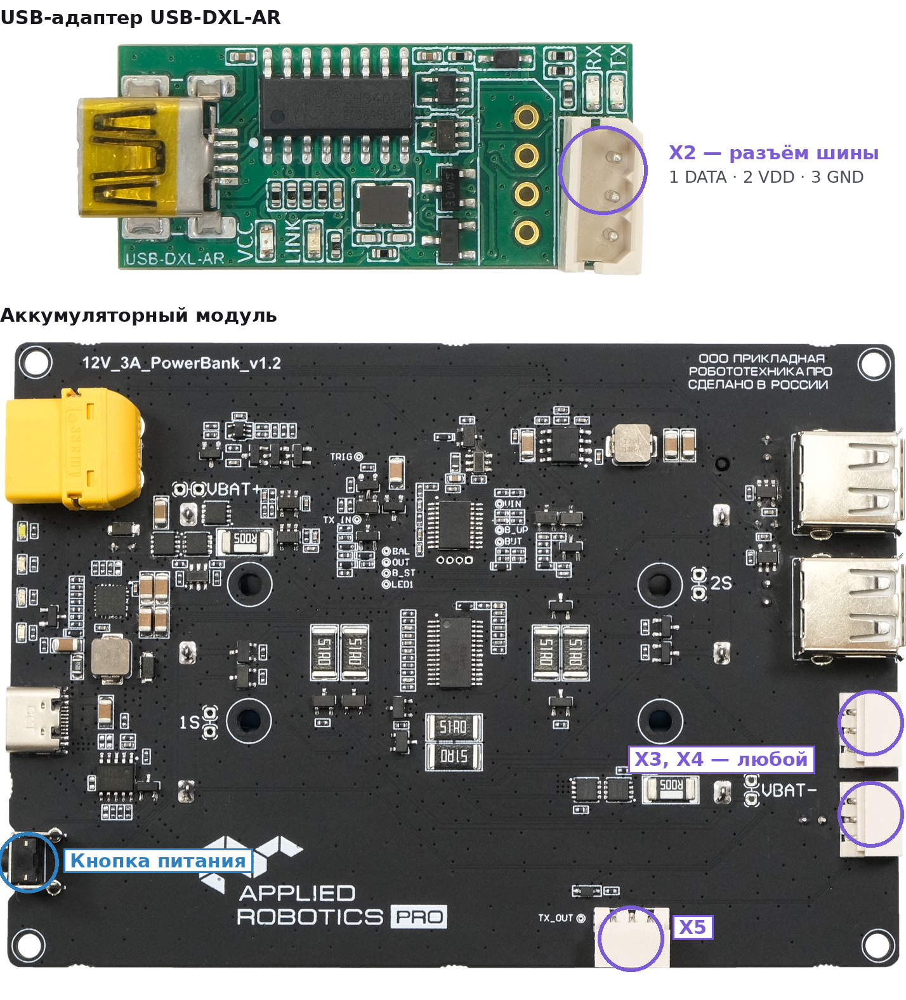
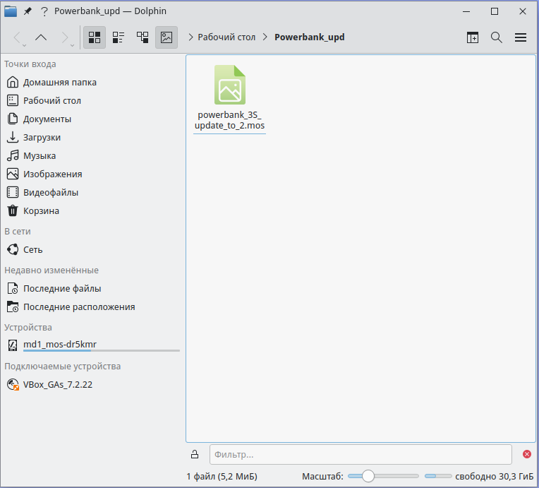
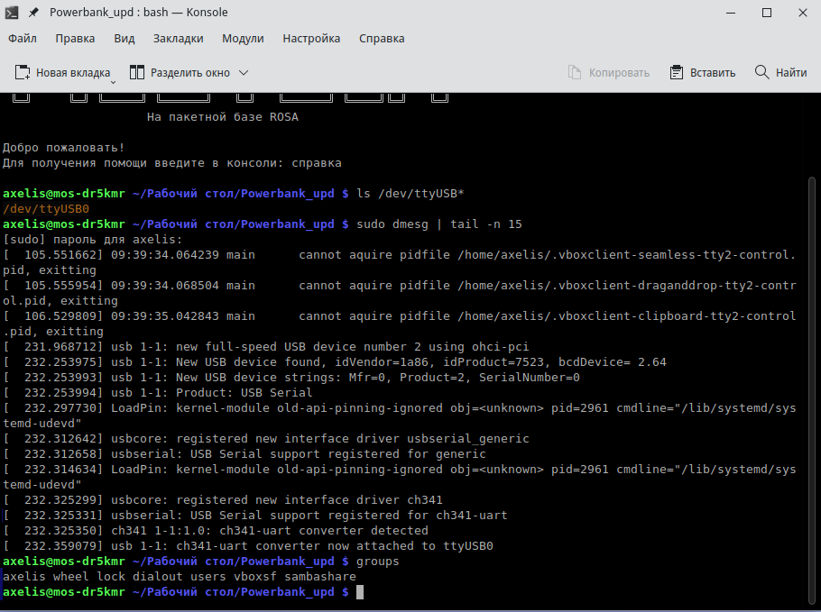
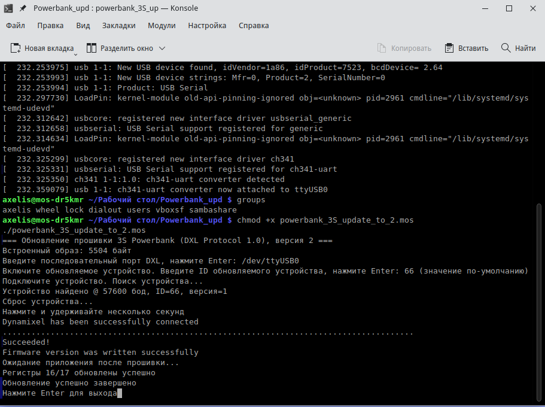
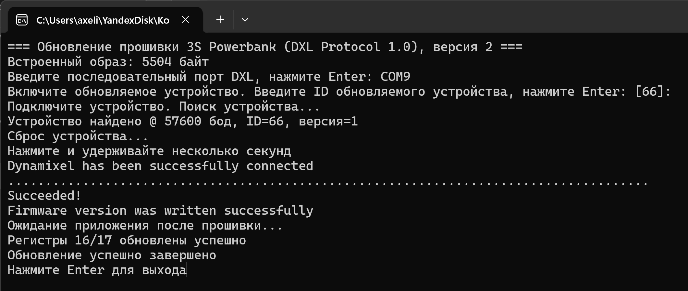
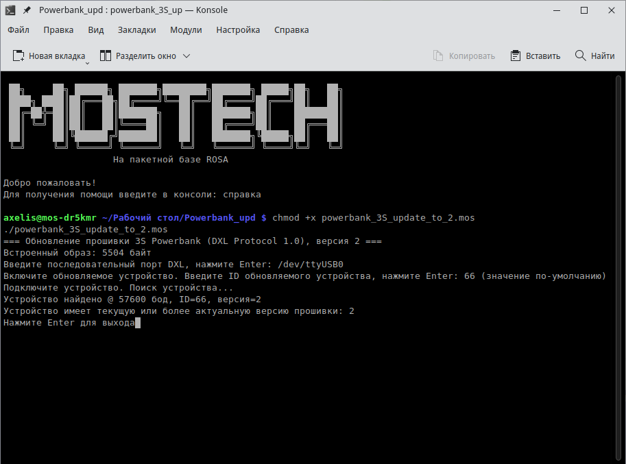

# Обновление прошивки аккумуляторного модуля

Аккумуляторный модуль 12V_3A_PowerBank v1.2 обновляется по шине DXL через USB-адаптер USB-DXL-AR. Готовая программа сама находит модуль, переводит его в загрузчик, записывает прошивку версии 2 и проверяет результат. Сама запись занимает меньше минуты.

В версии 2 модуль без нагрузки выключается через 45 минут, а не через 5, как раньше.

## Что понадобится

- Аккумуляторный модуль с заряженными аккумуляторами 3 × 18650: во время обновления он работает от них.

- USB-адаптер USB-DXL-AR, кабель USB mini-B и 3-проводной кабель шины DXL (разъёмы Molex, контакты DATA / VDD / GND).

- Компьютер с МОС Desktop 12 или Windows.

- Программа обновления из папки [`tools/powerbank_firmware_update`](../tools/powerbank_firmware_update): powerbank_3S_update_to_2.mos — для МОС, powerbank_3S_update_to_2.exe — для Windows. Прошивка уже встроена в программу, отдельных файлов не нужно.

- Проверено 6 ноября 2026 года: МОС Desktop 12 в виртуальной машине VirtualBox и Windows 11. В обоих случаях модуль обновился с версии 1 до версии 2.

## Шаг 1. Соедините адаптер с модулем

Соедините разъём X2 адаптера с любым из трёх разъёмов шины на модуле: X3, X4 или X5. Они включены параллельно, поэтому подходит любой. Модуль пока не включайте.



Адаптер модуль не питает: контакт VDD с USB не связан. Модуль работает только от своих аккумуляторов.

## Обновление в МОС Desktop 12

### Шаг 2. Скопируйте программу

Скопируйте файл powerbank_3S_update_to_2.mos в любую папку, например на рабочий стол. В тесте это была папка «Рабочий стол/Powerbank_upd».



### Шаг 3. Подключите адаптер и проверьте порт

1.  Вставьте адаптер в USB-порт компьютера.

2.  (Только VirtualBox) В окне виртуальной машины откройте **Устройства → USB** и выберите **QinHeng Electronics USB Serial**. Рядом с устройством появится галочка.

3.  Откройте терминал в папке с программой: в Dolphin нажмите **F4** или щёлкните правой кнопкой по пустому месту и выберите «Открыть терминал».

Выполните три команды:

```bash
ls /dev/ttyUSB*
sudo dmesg | tail -n 15
groups
```

Должно получиться так:

- первая команда показывает порт /dev/ttyUSB0;

- в выводе dmesg есть строка «ch341-uart converter now attached to ttyUSB0»;

- в списке групп есть dialout.



Если группы dialout нет, выполните команду ниже, затем **выйдите из сеанса и войдите снова**: группы применяются только к новому сеансу.

```bash
sudo usermod -aG dialout $USER
```

### Шаг 4. Запустите программу

В том же терминале дайте файлу право на запуск и запустите его:

```bash
chmod +x powerbank_3S_update_to_2.mos
./powerbank_3S_update_to_2.mos
```

### Шаг 5. Пройдите диалог программы

1.  «Введите последовательный порт DXL» — введите /dev/ttyUSB0 и нажмите Enter.

2.  «Включите обновляемое устройство. Введите ID…» — **включите модуль кнопкой питания** и нажмите Enter. Останется ID 66 по умолчанию.

3.  Программа найдёт модуль и покажет его версию: «Устройство найдено @ 57600 бод, ID=66, версия=1».

4.  «Нажмите и удерживайте несколько секунд» — **зажмите кнопку питания модуля и держите**, пока не появится «Dynamixel has been successfully connected» и не побегут точки. Потом кнопку можно отпустить.

5.  Не отключайте кабель и не выключайте модуль, пока идут точки.

6.  В конце появится «Регистры 16/17 обновлены успешно» и «Обновление успешно завершено». Нажмите Enter, чтобы закрыть программу.



## Обновление в Windows

### Шаг 2. Найдите COM-порт

1.  Вставьте адаптер в USB-порт компьютера. Если он был передан в виртуальную машину, сначала снимите галочку в меню VirtualBox **Устройства → USB**.

2.  Откройте **Диспетчер устройств** (Win + X → Диспетчер устройств), раздел **Порты (COM и LPT)**.

3.  Найдите строку **USB-SERIAL CH340 (COMx)** и запомните номер порта. В тесте это был COM9.

Если вместо порта видно «Неизвестное устройство», установите драйвер CH340 с сайта производителя микросхемы (wch.cn, файл CH341SER.EXE).

### Шаг 3. Запустите программу

Дважды щёлкните powerbank_3S_update_to_2.exe — откроется окно консоли. Если появится окно «Windows защитила ваш компьютер», нажмите **Подробнее → Выполнить в любом случае**: у программы нет цифровой подписи.

### Шаг 4. Пройдите диалог программы

Диалог такой же, как в МОС (Шаг 5 выше). Отличаются только имя порта и вид подсказки ID:

1.  На вопрос про порт введите номер порта, например COM9, и нажмите Enter.

2.  На «Включите обновляемое устройство… \[66\]:» включите модуль кнопкой и нажмите Enter.

3.  На «Нажмите и удерживайте несколько секунд» зажмите кнопку модуля, пока не побегут точки.

4.  Дождитесь «Обновление успешно завершено» и нажмите Enter.



## Как проверить результат

Запустите программу ещё раз и пройдите первые шаги диалога. Обновлённый модуль ответит с версией 2, а программа сообщит «Устройство имеет текущую или более актуальную версию прошивки: 2» и закончит работу, ничего не меняя.



## Если что-то пошло не так

- **«Порт … не найден».** Проверьте имя порта (Шаг 3 для МОС, Шаг 2 для Windows). В VirtualBox адаптер должен быть отмечен в меню **Устройства → USB**.

- **«Порт … недоступен или занят».** Закройте другие программы, которые могут держать порт: Arduino IDE, монитор порта, среду AR BBL. В МОС проверьте группу dialout.

- **Программа долго пишет «Поиск устройства...».** Модуль не включён, кабель не в том разъёме или разряжены аккумуляторы. Проверьте, горят ли светодиоды заряда на модуле.

- **Программа остановилась на «Нажмите и удерживайте несколько секунд».** Зажмите кнопку питания модуля и держите. Если точки так и не появились, закройте программу, выключите модуль и начните заново.

- **Программа пишет, что версия уже 2.** Модуль уже обновлён, делать ничего не нужно.

## Что пока не проверено

- Работа на настоящем компьютере с МОС, а не в виртуальной машине.

- Сборка программы для обычного Linux (файл без расширения).

- Повторный запуск после прерванной записи. Если запись оборвалась и модуль после этого не находится, обновление по шине может не получиться — тогда понадобится прошивка через разъём SWIM на плате.

